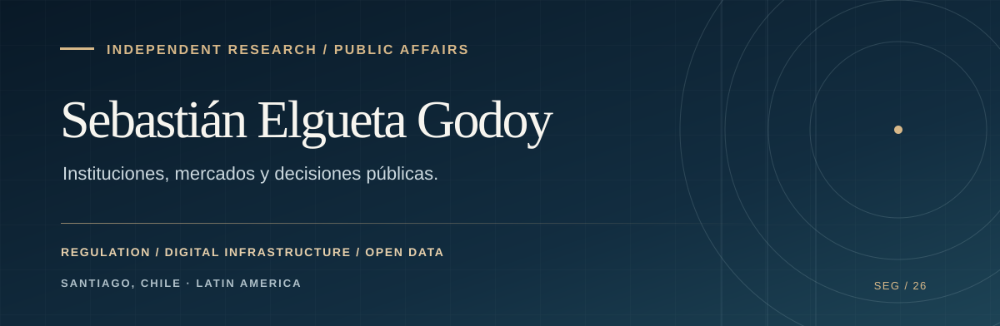

**Sociólogo · Dos magísteres · Asuntos públicos · Regulación · Investigación aplicada**

**Chile & Latinoamérica**

[**Portafolio profesional**](https://selguetagodoy.github.io/) &nbsp;·&nbsp; [**Laboratorio digital**](https://selguetagodoy.github.io/laboratorio.html) &nbsp;·&nbsp; [**Investigación**](https://selguetagodoy.github.io/investigacion.html) &nbsp;·&nbsp; [**Datos abiertos**](https://selguetagodoy.github.io/datos-abiertos.html) &nbsp;·&nbsp; [**English bio**](https://selguetagodoy.github.io/bio-en.html)

---

## Investigar, conectar evidencia y comprender decisiones

Trabajo en la intersección entre **Estado, mercados y sociedad**, combinando experiencia institucional, análisis regulatorio, infraestructura digital y datos territoriales. He trabajado en **SUBTEL, el Senado de Chile y FOSIS**, y en consultoría estratégica de asuntos públicos.

Este GitHub reúne **investigaciones abiertas, aplicaciones interactivas y recursos reproducibles**. Los resultados públicos mantienen sus fuentes y límites metodológicos identificados; no se incluyen antecedentes confidenciales de clientes.

## Proyectos destacados · Selected work

### 01 / Atlas de la Desconexión Digital
**Inclusión digital · Territorio · Chile**

Visualizador comunal para explorar conectividad y vulnerabilidad digital.

[**Explorar visualizador ↗**](https://atlas-visualizador-cotel.vercel.app/) · [Estudio y metodología](https://selguetagodoy.github.io/atlas-desconexion-digital-chile.html) · [Repositorio](https://github.com/selguetagodoy/atlas-visualizador-cotel)

### 02 / Data centers e infraestructura digital
**Energía · Regulación · Inversión**

Panel comparativo de diez hubs con metodología y límites de cada indicador documentados.

[**Explorar dashboard ↗**](https://selguetagodoy.github.io/dashboard-data-centers-2026.html) · [Benchmark internacional](https://selguetagodoy.github.io/benchmark-data-centers-2026.html) · [Metodología](https://selguetagodoy.github.io/metodologia-reproducibilidad.html)

### 03 / RINDELAB
**Movilidad · Eficiencia energética · Chile**

Comparación de vehículos y costos energéticos con datos oficiales y supuestos explícitos.

[**Abrir RINDELAB ↗**](https://selguetagodoy.github.io/rindelab/) · [Código y documentación](https://github.com/selguetagodoy/selguetagodoy.github.io/tree/main/rindelab) · [Fuentes y metodología](https://selguetagodoy.github.io/rindelab/metodologia.html)

## Investigación y datasets citables

- **[Latin America Digital Infrastructure](https://selguetagodoy.github.io/dataset-latin-america-digital-infrastructure.html)** — infraestructura digital, cloud, IXPs y energía en ocho mercados. [DOI 10.5281/zenodo.22921175](https://doi.org/10.5281/zenodo.22921175)
- **[Chile Digital Inclusion](https://selguetagodoy.github.io/dataset-chile-digital-inclusion.html)** — inclusión digital y desigualdades territoriales en 346 comunas. [DOI 10.5281/zenodo.22921191](https://doi.org/10.5281/zenodo.22921191)
- **[Atlas de la Desconexión Digital](https://selguetagodoy.github.io/atlas-desconexion-digital-chile.html)** — vulnerabilidad y fragilidad digital. [DOI 10.5281/zenodo.22921209](https://doi.org/10.5281/zenodo.22921209)
- **[Velocidades de Internet](https://selguetagodoy.github.io/dataset-velocidades-internet.html)** — series de conectividad de Chile y comparadores. [DOI 10.5281/zenodo.22921203](https://doi.org/10.5281/zenodo.22921203)
- **[Chile State Institutional Map](https://selguetagodoy.github.io/dataset-chile-state-institutional-map.html)** — organismos y competencias del Estado. [DOI 10.5281/zenodo.22921221](https://doi.org/10.5281/zenodo.22921221)
- **[Stakeholder Routes Chile](https://selguetagodoy.github.io/dataset-stakeholder-routes-chile.html)** — actores y rutas de decisión pública. [DOI v0.2.0](https://doi.org/10.5281/zenodo.22921234)

**Principios de trabajo:** fuentes identificadas · universos comparables · datos faltantes explícitos · reproducibilidad · versiones citables. La fecha de los depósitos en Zenodo y la de los releases en GitHub puede diferir; las citas deben corresponder a la versión consultada.

[**Explorar todos los datasets ↗**](https://selguetagodoy.github.io/datos-abiertos.html) · [Metodología y reproducibilidad](https://selguetagodoy.github.io/metodologia-reproducibilidad.html) · [Estado de investigación](https://selguetagodoy.github.io/estado-investigacion.html) · [Portfolio JSON](https://selguetagodoy.github.io/research-portfolio.json)

## Trayectoria y publicaciones

Más de **13 años de experiencia** en asuntos públicos, asesoría legislativa, regulación, articulación público-privada e investigación aplicada. Formación en **Sociología**, **Gestión de Proyectos Urbano-Regionales** y **Comunicación Política y Asuntos Públicos**.

**Análisis y publicaciones:** [CIPER — El próximo paso del 5G](https://www.ciperchile.cl/2026/07/10/el-proximo-paso-del-5g/) · [COTEL — nueva brecha digital](https://cotel.cl/la-nueva-brecha-digital-combina-uso-dispositivos-y-presupuesto/) · [Publicaciones](https://selguetagodoy.github.io/publicaciones.html)

**Perfil profesional:** [Experiencia](https://selguetagodoy.github.io/experiencia.html) · [Formación](https://selguetagodoy.github.io/formacion.html) · [LinkedIn](https://cl.linkedin.com/in/sebastian-elgueta-godoy) · [Contacto](https://selguetagodoy.github.io/contacto.html)

<strong>English · Research profile</strong>

Sociologist and public-affairs consultant with two master's degrees in urban/regional project management and political communication/public affairs. My work spans regulatory affairs, public policy, digital infrastructure, telecommunications, digital inclusion and territorial research in Chile and Latin America. This portfolio features public-source, documented research and citable outputs. Client-confidential work is excluded.

**Explore:** [Professional bio](https://selguetagodoy.github.io/bio-en.html) · [Research](https://selguetagodoy.github.io/investigacion.html) · [Open data](https://selguetagodoy.github.io/datos-abiertos.html)

---

Sebastián Elgueta Godoy · Santiago, Chile · Research portfolio · <a href="https://selguetagodoy.github.io/">selguetagodoy.github.io</a>
